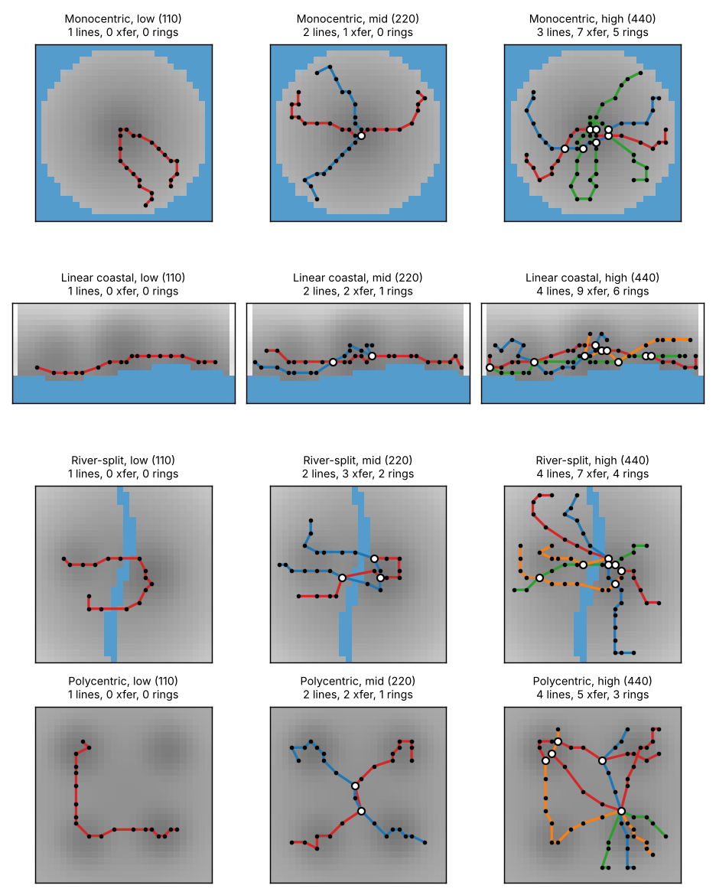
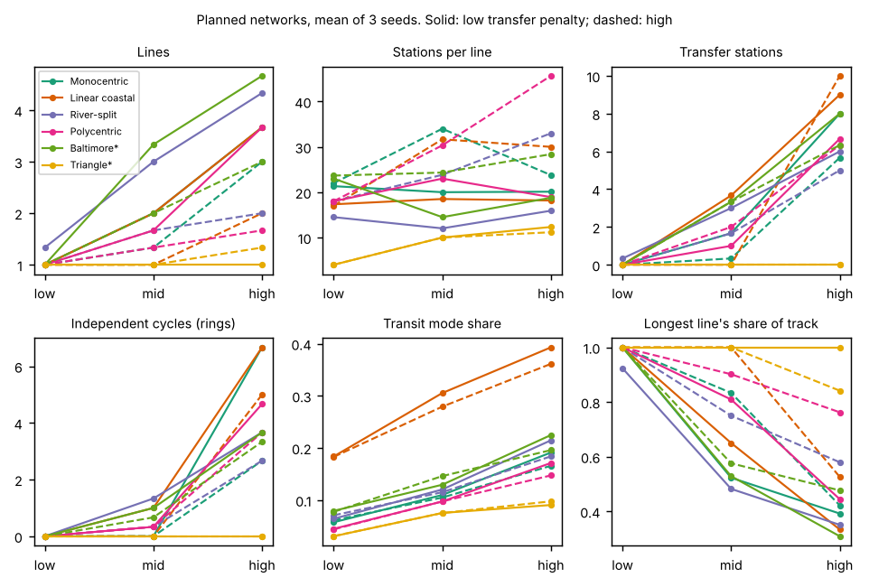
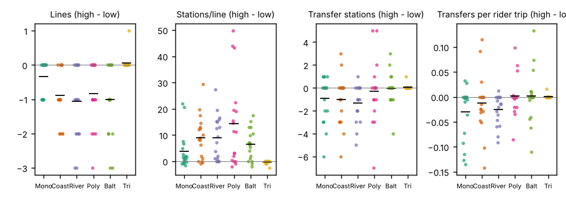
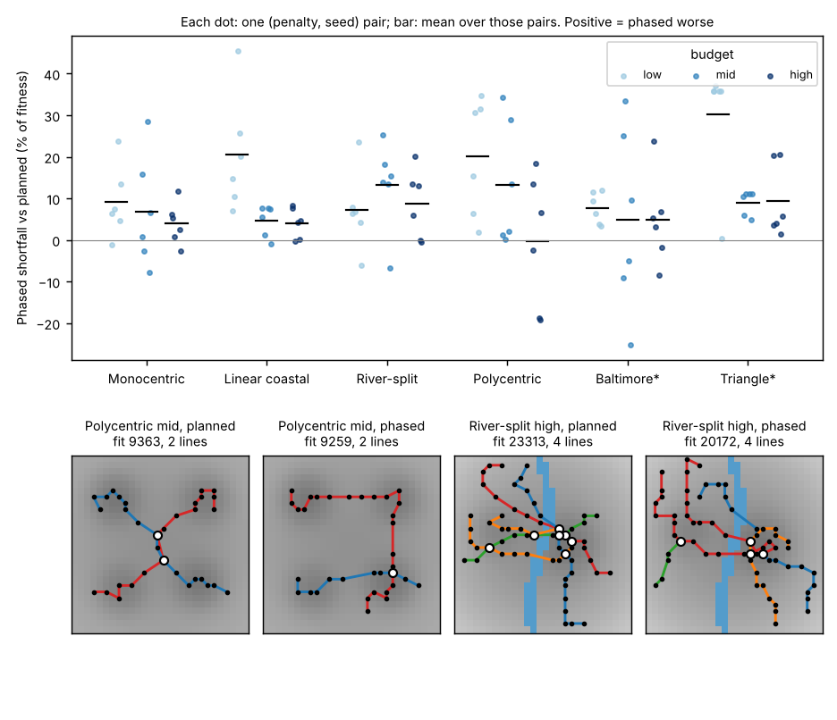
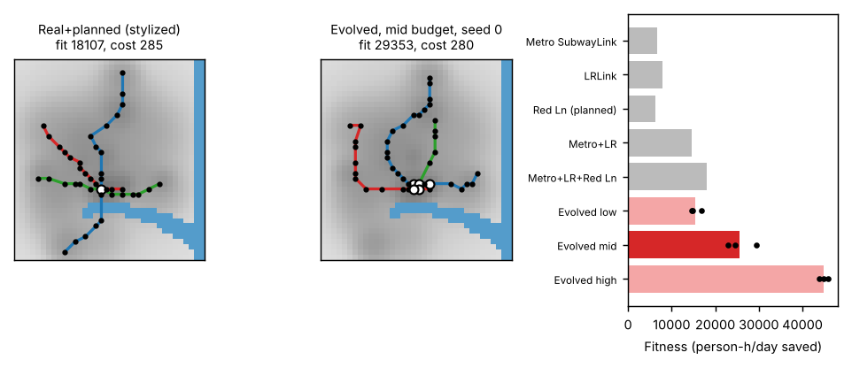
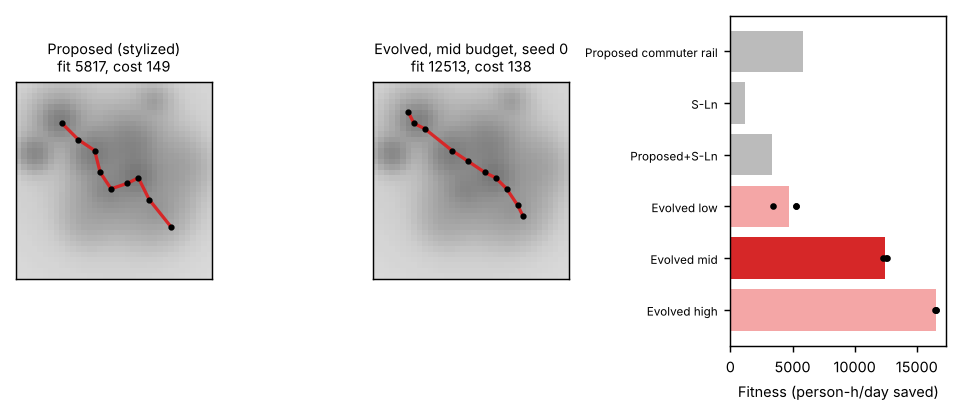

# Evolved Subway Networks on Synthetic and Stylized Cities: Budget, Transfer Penalty, Phasing, and Two Real-City Comparisons

## Abstract

We evolve subway networks (ordered station lists) on six coarse-grid cities under a hard construction budget. Fitness is the daily person-hours of generalized travel time saved relative to driving, computed over a gravity-model origin-destination matrix with walk access, fleet-limited waits, in-vehicle time, a transfer penalty and logit mode choice. We sweep 6 cities x 3 budgets x 2 transfer penalties x 2 build modes (planned, or three frozen tranches) x 3 seeds (216 runs). Findings that held in all or most seeds: networks grow from one line to three or four lines as the budget doubles twice, with transfers and cycles appearing only at the mid and high budgets; a high transfer penalty gives about 30% fewer lines that are about 40% longer in stations; phased networks fall short of planned ones by about 10% on average (about 7% median), mostly through fewer transfer stations and cycles, and the shortfall shrinks as the budget grows; at Baltimore's stylized real-system cost the optimizer beats Metro + Light Rail + Red Line by 42% (low penalty) in the model, and in the Triangle it beats a stylized proposed commuter rail by 2.1x, but that second result flips sign if the driving speed assumption rises from 50 to 60 km/h. All of this is conditional on a hand-calibrated stylized model; none of it is a forecast. Of 22 pre-registered predictions, 8 were supported, 6 partly supported, 7 not supported and 1 did not replicate.

## 1. Introduction

Real subway systems tend to have a dense core with branches radiating from it (Roth et al., 2012, who report a core-and-branch structure across a set of world systems; we treat this only as a loose external reference). Is that shape something a budget-limited optimizer produces on its own, and how does it depend on city shape, transfer penalties, and whether the system is built in one plan or in stages? We built a small evolutionary design model to ask five questions: (Q1) how topology varies with budget and city shape; (Q2) whether a strong transfer penalty yields fewer, longer lines; (Q3) how much worse phased builds are, and how they differ structurally; (Q4) what the optimizer builds in a stylized Baltimore given the mileage of Metro SubwayLink, Light RailLink and the planned Red Line; (Q5) what it builds in a stylized Raleigh-Durham region given a budget matching a proposed commuter rail, and whether rail beats driving at all. Predictions were written and committed before any code (`PREDICTIONS.md`) and are scored in Section 6.

## 2. Methods

**Cities.** Each city is a grid of at most 40x40 cells (1 km cells; 1.7 km for the Triangle) with water cells, homes (workers) and jobs per cell, aggregated into 2x2-cell zones. Four synthetic shapes: monocentric round (28x28), linear coastal (18x40, a strip along a shoreline with three job centers), river-split (28x28, a winding river with a large east-bank center and a small west-bank center, 8 min added driving time between banks) and polycentric (28x28, four job centers). Two stylized real cities were drawn by hand from memory, with no data downloaded, and are approximations only: **Baltimore*** (38x36; downtown/Inner Harbor, Johns Hopkins Hospital, Homewood, Towson and other job centers; harbor and Patapsco water to the south and the Bay to the east; higher transit propensity in East and West Baltimore) and the **Triangle*** (36x36 at 1.7 km; Raleigh, Durham, Chapel Hill, RTP, Cary, Wake Forest; low density, polycentric, no water). Comparison networks: Metro SubwayLink, Light RailLink and the planned Red Line (Baltimore), and a proposed Durham-RTP-Cary-Raleigh-Garner-Clayton commuter rail and the S-Line to Wake Forest (Triangle), each snapped to cells and scored by the same fitness function. Total workers: 200k (synthetic), 420k (Baltimore), 700k (Triangle).

**Demand.** Flows follow a singly constrained gravity model, T_ij proportional to H_i J_j exp(-d_ij / gamma), with two one-way trips per worker (gamma = 8 km, 18 km for the Triangle). Intrazone trips are excluded. Driving generalized time is parking time (base plus a term increasing with destination density) plus 60 x circuity x distance / speed, inflated by a congestion factor that rises with origin and destination density, plus a river penalty where applicable.

**Network and costs.** A network is a set of lines; a line is an ordered list of at least two stations on land cells, joined by straight hops of 0.9 to 6 km (1.6 to 14 km in the Triangle). Cost = 2.5 per track km + 1.5 per unique station + 4.0 per km of water crossed (units are about $100M, stylized). Budgets are low/mid/high = 0.5x/1x/2x a mid value: 220 units for synthetic cities, and for Baltimore (287) and the Triangle (149) the model cost of the real/proposed networks (Metro + Light Rail + Red Line; the proposed commuter rail). The budget is a hard constraint: over-budget children are discarded.

**Travel time and fitness.** Stations in the same cell merge, so transfers happen only at shared stations. Each line gets vehicles from a fixed fleet (0.2 vehicles per budget unit) split in proportion to cycle time with a floor of 2 vehicles per line; cycle time includes 4 minutes of layover at each end, so more lines mean longer headways (2 to 30 min bounds). Generalized transit time = 1.2 x access (walk, or 25 km/h feeder in the Triangle, to the nearest 4 stations within 1.2 km, or 6 km) + 1.5 x wait (half headway) + in-vehicle time (40 km/h; 60 km/h in the Triangle) + penalty x transfers. Mode choice is logit: p = 1/(1+exp(-(0.15 x (t_drive - t_transit) + ASC + 3q))), ASC = -0.5 (-1.5 Triangle), q = share of households without cars at the origin zone. Fitness = sum over OD pairs of flow x p x (t_drive - t_transit), in person-hours per day. This sum can be slightly negative for logit riders on slow routes, and it is not a welfare measure. The transfer penalty is 5 min (low) or 20 min (high).

**Optimizer.** A (16+32) evolutionary algorithm, 500 generations (about 11,000 evaluations per run), with mutations: move station, extend (at an end, or insert an interior station) or trim a line, add or delete a line, split or merge lines; stations may snap to another line's station to create transfers. A tiny cost tie-break (1e-3 per unit) prefers cheaper networks. **Planned:** the full budget and fleet at once. **Phased:** three tranches of 167 generations with cumulative caps of 1/3, 2/3 and the full budget (and proportional fleet); after each tranche the network is frozen (existing stations and track cannot be moved or removed, but lines may be extended at their ends, and new lines added). Seeds 0 to 2.

**Metrics.** Lines, stations, track km, stations per line, transfer stations (served by at least 2 lines), cycles (cyclomatic number of the station graph; this counts any independent cycle, including two lines that meet at two stations, not only orbital rings), mode share, transfers per rider, share of trips where transit is faster, water-crossing hops, dominant-line angle, budget used. Effect sizes are paired means (same city, budget, mode and seed) with bootstrap 95% intervals and Cohen's d_z; "replicates" means the same sign in all three seeds. All numbers below come from `results.csv` and `results/stats.json`. The whole sweep took 2.1 CPU-hours.

## 3. Verification

Six hand-computed unit tests (cost, travel time, transfers, closed-form fitness), three optimizer invariants (frozen cores preserved, no invalid mutations, budgets), a visual smoke test and a post-sweep audit are described in `TESTS.md`. The audit found no budget violations, stations in water or invalid hops in 216 runs. The smoke test caught three modeling problems that were fixed before the sweep (transit never beating driving, over-penalized access, and a Triangle degenerate optimum). **These fixes were calibration choices made after seeing outputs**, so the absolute level of mode share and savings is tuned, not measured (Section 5).

## 4. Results

### 4.1 Topology vs. budget and city shape (Q1)

Planned networks, mean of 6 runs (3 seeds x 2 penalties):

| City | Lines (low / mid / high) | Transfer stations | Cycles | Transit mode share |
|---|---|---|---|---|
| Monocentric | 1.0 / 1.7 / 3.3 | 0.0 / 1.0 / 6.8 | 0.0 / 0.0 / 4.7 | 5.9% / 10.7% / 17.8% |
| Linear coastal | 1.0 / 1.5 / 2.8 | 0.0 / 1.8 / 9.5 | 0.0 / 0.5 / 5.8 | 18.3% / 29.2% / 37.7% |
| River-split | 1.2 / 2.3 / 3.2 | 0.2 / 2.3 / 5.5 | 0.0 / 0.8 / 3.2 | 6.7% / 11.8% / 19.9% |
| Polycentric | 1.0 / 1.5 / 2.7 | 0.0 / 1.5 / 6.5 | 0.0 / 0.3 / 4.2 | 4.4% / 9.7% / 15.9% |
| Baltimore* | 1.0 / 2.7 / 3.8 | 0.0 / 3.3 / 7.2 | 0.0 / 0.8 / 3.5 | 7.8% / 13.8% / 21.0% |
| Triangle* | 1.0 / 1.0 / 1.2 | 0.0 / 0.0 / 0.0 | 0.0 / 0.0 / 0.0 | 3.1% / 7.5% / 9.4% |

The low budget always gives one line (105 of 216 runs are single-line). Transfers and cycles appear at mid and grow quickly at high. Line count grows faster than the budget in the synthetic cities (about 3x for a 4x budget, 1.7 to 4.7x across city-penalty pairs). The monocentric city is radial at low and mid budgets (zero cycles in all 6 runs) and grows cycles only at the high budget (5 of 6 runs), where the extra lines overlap near the center rather than forming a clean orbital ring. The coastal city's longest line lies within about 6 degrees of the shoreline axis at every budget, as expected for an elongated city. The river city crosses the river 1 to 2 times at the low budget, 2 to 3 at mid and 4 to 5 at high. The Triangle never gets more than about 1.2 lines, never forms transfers, and leaves 35% of the high budget unspent, because beyond a single Durham-RTP-Raleigh spine each extra track-km buys little in this low-density setting. Differences between city shapes in transfers per line (the polycentric city is not the highest) were not what we predicted and are small relative to seed variation (planned fitness has a median seed-to-seed CV of 5%).

### 4.2 Transfer penalty (Q2)

A 20 minute penalty versus 5 minutes, paired over 108 matched runs: lines fall 30% in pooled means (2.24 to 1.56; paired d_z = -0.75; mean per-run relative change -20%, 95% CI -25% to -15%), stations per line rise 42% (16.5 to 23.5; CI +31% to +53%), mean line length rises by 12.4 km, transfer stations fall 24% and cycles fall 37% (pooled means). The direction replicates well: in no condition did the high penalty produce more lines than the low penalty in all 3 seeds, and in no condition fewer stations per line. Many low-budget conditions are single-line either way, so the effect lives at mid and high budgets (at mid, 5 of 6 cities have fewer lines; the Triangle is one line in both). The cost in fitness is small: the high-penalty optimum scores 3% lower in paired terms (CI -6% to -1%, d_z = -0.24), and a network optimized under the low penalty and scored under the high penalty loses a similar 3%. That fitness difference is lower in only 61% of runs, so we flag it as weakly replicating.

### 4.3 Phased vs. planned (Q3)

Phased networks have lower fitness in 83% of the 108 pairs, by a mean of 9.8% (95% CI 7.5% to 12.3%) and a median condition gap of 7.3%; the phased network was worse in all three seeds in 58% of conditions. The worst condition mean shortfall was 36% (Triangle, low budget). The gap is not larger at larger budgets. It is the opposite: 15.8% at low, 8.7% at mid and 5.1% at high budget. In the low-budget case the first tranche (a third of the budget) commits the network to a corridor before the full plan can be seen. Structure: phased networks have fewer cycles (-0.59 per network; CI -0.96 to -0.25; d_z = -0.31), fewer transfer stations (-0.72; CI -1.24 to -0.23), a 1.3 percentage-point lower mode share (d_z = -0.89) and 3.4 km less track. They do not differ reliably in line count (+0.05, CI -0.09 to +0.19), stations per line (CI -2.0 to +1.0) or longest-line share (+0.003). Because planned fitness itself has a median 5% seed CV and the optimizer is heuristic, individual phased-versus-planned gaps below about 5% should not be read as real; in 17% of pairs the phased result was at least as good.

### 4.4 Baltimore (Q4)

The three real/planned lines cost 285 model units and score 18,107 person-h/day at the low transfer penalty (mode share 14.1%). Metro + Light Rail alone scores 14,686, so the Red Line adds 23% (24% at the high penalty). At the same budget the evolved networks score 25,646 on average (range 22,963 to 29,353), a gain of 42% over the real system; at the high penalty 27,587 vs. 16,444, a gain of 68% (the worst seed still beats it by 27% and 56%). At half the budget the optimizer reaches 85% of the real system's score. At double the budget it reaches 2.4x. Evolved networks put stations within 0.3 km of downtown and within about 1 km of Johns Hopkins Hospital in nearly every run. They reached within 1.5 km of Homewood in only 2 of 6 mid-budget runs, within 2.6 km of the West Baltimore reference point in all 6, and they commonly still run out to Owings Mills (within 1.1 km in 5 of 6 runs) and Hunt Valley (within 2.5 km in 4 of 6); no run reached BWI. Mode share at the mid budget is 13 to 15% for evolved networks.

### 4.5 Triangle (Q5)

At the budget of the proposed commuter rail (149 units), the optimizer builds a single Durham-RTP-Raleigh-Garner spine, which passes within 1.8 km of the Raleigh, RTP and Durham centers in all 6 mid-budget runs and 11 km or more from Chapel Hill and 22 km from Wake Forest. It scores 12,466 versus 5,817 for the proposed alignment (2.1x; every seed at least 2.1x). Transit mode share at the mid budget is 7.5% and 9.4% at the high budget; transit is faster than driving for 13% to 17% of trips at mid and high budgets. So in this model, rail does help for a meaningful minority of trips along a single corridor. This conclusion is sensitive to one assumption. Re-scoring the same networks with the driving speed raised from 50 to 55 and 60 km/h drops the proposed rail's fitness from 5,817 to 920 and to -1,414, and the evolved network's from 12,500 to 5,200 and 1,100, with mode share falling to 5.8% and 4.5%. At 45 km/h the numbers roughly double. The optimizer always beats the proposal across these settings, but whether rail beats driving at all depends on the driving baseline. Per worker, the evolved Triangle network saves 0.018 h/day versus 0.061 for Baltimore (3.4x lower, and about equal per budget unit).

## 5. Limitations

All parameters were set by hand and several were adjusted after smoke tests so that transit could compete with driving at all (Section 3), so absolute savings and mode shares are calibrated, not estimated. Real-city geography, job and population fields, and line alignments are drawn from memory and stylized; they should not be read as statements about Baltimore or the Triangle. Zones are 2x2 cells, so access distances are crude. A single cost function is applied to subway, light rail and commuter rail; the Triangle uses 60 km/h rail and 25 km/h feeder access, other cities 40 km/h and walking. The fleet is a fixed function of the budget (0.2 vehicles per unit), so a large budget also buys a large fleet, and equal-headway allocation means line count affects waits mostly through layover and the 2-vehicle floor. Phased builds use a proportional fleet per tranche and allow only end-extensions of frozen lines. The optimizer is a heuristic with about 11,000 evaluations per run and 3 seeds per condition: seed CV is 5% median and 24% worst, so small differences are not resolved and conditions with all-3-seed sign agreement are the ones we trust. The "cycle" count includes overlapping lines, not only orbital rings. Mode choice uses one logit slope; fitness is a sum of time saved among logit choosers, not consumer surplus. We did not vary the other parameters; only the Triangle driving speed was probed.

## 6. Scoring the predictions (`PREDICTIONS.md`)

"Supported" means the stated quantity fell in the stated range with a replicating sign; "partly" means some clauses held.

| # | Prediction (short) | Result | Verdict |
|---|---|---|---|
| P1a | High-budget line count 1.5x to 3x the low | Ratios 1.7 to 4.7 (5 of 10 non-Triangle city-penalty pairs above 3x); Triangle 1.0 to 1.3 | Not supported |
| P1b | Monocentric: no cycle at low/mid; cycle at high in 2 of 3 seeds | 0 cycles in all 12 low/mid runs; at high 5 of 6 runs have cycles (3 of 3 low penalty, 2 of 3 high) | Supported (with cycle caveat) |
| P1c | Coastal: line within 20 degrees of axis; at most 1 cycle | Angle within 6 degrees at every budget; but 3 to 8 cycles at the high budget | Partly |
| P1d | River crossings at most 2 (low), at most 4 (high) | Low 1 to 2 (supported); high 4 to 5 (not supported) | Partly |
| P1e | Polycentric has the most transfers per line among synthetic cities | Coastal and river exceed it at mid and high | Not supported |
| P1f | Mode share gain low to mid exceeds mid to high | Holds only for coastal and the Triangle; reversed for mono, river, polycentric, Baltimore | Not supported |
| P2a | At least 15% more stations per line under high penalty | +42% (CI +31% to +53%); higher in all 3 seeds in 42% of conditions, never lower | Supported |
| P2b | Fewer lines under high penalty in at least 4 of 6 cities at mid | 5 of 6 (Triangle tied at 1) | Supported |
| P2c | 10 to 30% fewer transfer stations | -24% pooled; many conditions are 0 vs 0 | Supported (modest replication) |
| P2d | Lower fitness, within 10% | -3% paired (CI -6% to -1%); lower in only 61% of runs | Partly (small, weakly replicating) |
| P3a | Median gap 3 to 10%, worst under 25% | Median 7.3% (yes); worst condition 36% (no); phased worse in 83% of runs | Partly |
| P3b | Gap larger at high budget than low | Reversed: 15.8% low, 8.7% mid, 5.1% high | Not supported |
| P3c | Phased: more lines, fewer stations per line, lower longest share, fewer cycles | Only cycles (and transfers) are lower; the rest are null | Partly (1 of 4) |
| P3d | Gap larger in polycentric and river than monocentric | +3 to +4 points, CI includes 0 (differences positive in 61 to 67% of matched pairs) | Non-replicating |
| P4a | Optimizer beats the real network by at least 20% | +42% (low penalty), +68% (high); worst seed +27% / +56% | Supported |
| P4b | North-south spine via downtown and Homewood, east-west line for East and West Baltimore, no suburban tails | Downtown and JHH always served; Homewood only 2 of 6; Owings Mills and Hunt Valley often served (5 of 6, 4 of 6); BWI never. Spine and east-west geometry not tested directly | Partly / not supported |
| P4c | Red Line adds at least 25% over Metro + Light Rail | +23% (low penalty), +24% (high) | Not supported (narrowly) |
| P4d | Transit mode share under 25% | 13 to 15% at mid, 20 to 22% at high | Supported |
| P5a | Links Raleigh, RTP, Durham, not Wake Forest or Chapel Hill | Raleigh, RTP and Durham within 1.8 km in all mid runs; Chapel Hill 11 km, Wake Forest 22 km away | Supported |
| P5b | Beats the proposed rail by at least 30% | 2.1x at mid, all seeds; sign of the proposal's own fitness flips with the driving speed | Supported (assumption-sensitive) |
| P5c | Mode share under 8% at high budget and under 10% of OD pairs transit-faster | 9.4% at high (7.5% at mid); 13 to 17% of trips transit-faster | Not supported |
| P5d | Per-capita savings at least 5x lower than Baltimore | 3.4x lower per worker; equal per budget unit | Not supported |

Tally of the 22 rows: 8 supported, 6 partly supported, 7 not supported, 1 non-replicating. Several predictions had round-number thresholds that missed by small margins (P4c, P5c, P1d), which the table shows explicitly.

## 7. Addendum (v2): robustness, convergence, and real data

Sections 1 to 6 are the original analysis and are unchanged, including the prediction scoring. This addendum used extra compute to attack the limitations in Section 5. New code: `run_sweep2.py`, `analysis2.py`, `analysis3.py`, `build_realdata.py`, `acs_validation.py`. New data: `results/v2/`, `results/stats_v2.json`, `results/stats_real.json`, `results/structure_posthoc.csv`.

### 7.1 More seeds, longer runs

Seeds 3 to 9 were added for every condition (10 seeds, 720 runs in the base design). Headline effects are stable: a high transfer penalty gives 28% fewer lines (ratio 0.72), 39% more stations per line and 24% fewer transfer stations; the fitness cost of the penalty shrinks to 1.3%. The phased shortfall is 9.3% on average (6.7% median), phased is worse in 79% of pairs, and it is 15.4%, 8.0% and 4.3% at low, mid and high budget, so the reversed budget trend (P3b) holds. The polycentric-minus-monocentric gap difference is -0.4 points, so P3d is a clear null. Against the stylized real systems, the evolved network at the real budget scores 1.49x (low penalty) and 1.68x (high penalty) the Baltimore system (worst of 10 seeds 1.27x and 1.54x), and 2.16x the proposed Triangle rail (worst seed 2.11x).

Convergence: re-running the 54 low-penalty planned conditions at 1,500 generations (3 seeds) improved fitness over the 500-generation result in 74% of runs, by 4.7% on average (median 2.3%, worst case +29%, largest in Baltimore at +8%, smallest in the Triangle at +0.5%). Seed CV falls from 5.0% to 4.1%. So the 500-generation optimizer is within about 5% of what it finds with 3x the effort, but is not converged; planned fitness is slightly understated, and phased-versus-planned gaps below about 5% remain unresolved.

### 7.2 Sensitivity to behavioral parameters

Eight one-at-a-time perturbations were each run across all 6 cities x 3 budgets x 2 penalties x 2 build modes x 2 seeds (1,152 runs): driving speed -10% / +10%; transit constant -0.5 / +0.5; logit slope 0.10 / 0.22; fleet 0.1 / 0.4 vehicles per budget unit.

| Variant | Lines ratio (high/low pen) | Stations/line ratio | Phased gap, mean (low / high budget) | Baltimore: evolved / real | Triangle: evolved / proposed | Triangle mid mode share |
|---|---|---|---|---|---|---|
| base (seeds 0-1) | 0.70 | 1.42 | 9.9% (17.1 / 4.6) | 1.45 | 2.13 | 7.5% |
| drive -10% | 0.74 | 1.38 | 6.1% (10.7 / 7.2) | 1.39 | 1.26 | 10.1% |
| drive +10% | 0.71 | 1.43 | 10.8% (16.3 / 2.7) | 2.03 | 5.94 | 4.6% |
| transit constant -0.5 | 0.78 | 1.26 | 7.9% (12.7 / 6.5) | 1.39 | 2.21 | 5.6% |
| transit constant +0.5 | 0.73 | 1.38 | 10.2% (16.4 / 5.7) | 1.47 | 2.16 | 9.8% |
| slope 0.10 | 0.70 | 1.36 | 13.3% (25.2 / 7.6) | 1.83 | 2.87 | 6.4% |
| slope 0.22 | 0.74 | 1.32 | 8.5% (13.6 / 6.5) | 1.54 | 1.90 | 8.3% |
| fleet 0.1 | 0.75 | 1.29 | 16.7% (30.1 / 7.0) | 1.64 | 5.10 | 4.6% |
| fleet 0.4 | 0.71 | 1.44 | 3.5% (8.4 / 1.9) | 1.46 | 1.83 | 8.8% |

What survives all nine settings: fewer and longer lines under a high penalty (lines ratio 0.70 to 0.78, stations per line 1.26 to 1.44; transfer stations fall in every setting but by 8% to 67%); phased worse than planned on average (3.5% to 16.7%) and worse at low than at high budget (all nine settings); the evolved network beating the stylized Baltimore system (1.39x to 2.03x) and the proposed Triangle rail (1.26x to 5.94x). What does not survive: the polycentric-versus-monocentric gap difference changes sign across settings (-6.6 to +11.8 points), and the Triangle's absolute level. The proposed Triangle rail's own fitness runs from 920 (driving +10%) to 15,372 (driving -10%), and mode share at the mid budget from 4.6% to 10.1%. The fitness-change-under-penalty column is omitted because a relative change is unstable where baseline fitness is near zero (the logit slope 0.10 and driving +10% settings).

### 7.3 Real data: observed commute flows, real water, and an ACS check

Using the allowed Census hosts we downloaded LEHD LODES 2022 origin-destination commute flows and block centroids for Maryland and North Carolina, and TIGER 2022 area water. For two new cities, `baltimore_lodes` and `triangle_lodes`, grids are anchored on real latitude and longitude (Baltimore: 38x36 cells of 1 km; Triangle: 36x36 cells of 1.7 km). Observed worker flows between zones replace the gravity model (431,518 workers in Baltimore pairs and 605,516 in the Triangle, only flows with both ends inside the grid); water is rasterized from TIGER polygons larger than 0.3 km2. Transit alignments (Metro, Light RailLink, Red Line; proposed commuter rail, S-Line) are still approximate station coordinates written from memory, now in latitude and longitude, so they remain approximate. All behavioral parameters are unchanged from Sections 2 and 3, with no re-tuning. The sweep is 2 cities x 3 budgets x 2 penalties x 2 modes x 5 seeds = 120 runs.

**The gravity model is adequate for what we use it for.** With the decay parameter fitted to the observed mean trip length, gravity flows correlate with the observed flows at r = 0.95 (Baltimore) and 0.94 (Triangle) at the zone-pair level, and match the mean trip length (11.3 km, 17.4 km) by construction. It underpredicts short trips (share of trips under 5 km: 21.6% observed vs 18.2% in Baltimore). The real networks score within 2.5% of each other under the two demand models (10,755 vs 10,494 Baltimore; 4,819 vs 4,663 Triangle), and the evolved networks rescored under gravity demand change by under 11%.

**ACS check on the mode-choice calibration.** Modeled transit share for the real Baltimore network is 7.0% of in-grid trips, against 6.4% ACS transit commute share (which includes buses). The zone-level correlation between modeled and ACS origin shares is r = 0.44 (242 zones; Spearman 0.39). For the Triangle the model gives 4.6% for the proposed rail against 1.3% ACS, which is bus-only because there is no rail, with r = 0.20. So the Baltimore calibration is plausible and the Triangle is probably too favorable to transit by a factor of a few; read the Triangle as an upper bound on rail's draw. The ACS comparison was done with the Census API (key kept in a git-ignored local file).

**Evolved vs real, with real data.**

| | Real/proposed network fitness | Evolved at 0.5x / 1x / 2x budget (mean of 5 seeds, low penalty) | Ratio at 1x (worst seed) | Mode share at 1x |
|---|---|---|---|---|
| Baltimore (real data) | 10,755 (Metro + Light Rail + Red Line); Metro + LRT alone 9,340 | 12,234 / 21,549 / 41,168 | 2.00 (1.49) | 9.0% |
| Triangle (real data) | 4,819 (proposed commuter rail) | 1,902 / 5,854 / 9,229 | 1.21 (0.87) | 4.3% |

Baltimore's margin is larger in real data (2.0x vs 1.45x to 1.49x stylized). The Triangle's is much smaller (1.21x vs 2.1x), and in one of five seeds the optimizer does not beat the proposed alignment at its own budget. Real-data Triangle optima are also erratic: the best 1-line network at the low budget ranges 453 to 4,223 across seeds, because with one line the search can settle on very different corridors (Durham to Chapel Hill vs Raleigh to Wake Forest vs Durham to Raleigh). So the stylized Triangle overstated the advantage of optimization; with real flows the proposed corridor is closer to what the optimizer finds. In real data the Triangle at the high budget has a mode share of 6.3% (the original P5c prediction, under 8%, holds here), and per in-grid worker the Triangle saves 5.2 times less than Baltimore at the mid budget (0.0098 vs 0.0508 h/day; P5d predicted at least 5x, so it holds with real flows).

Structure with real flows: Baltimore evolved networks serve downtown (within 0.8 km) and Johns Hopkins Hospital (within 1.0 km) in every mid-budget seed, Homewood within 1.5 km in 1 of 5 mid-budget seeds and 2.4 km or closer in 4 of 5, and the Red Line component is worth 15% over Metro + Light Rail (below the 25% in P4c). Owings Mills is served within 1.4 km in 3 of 5 and Hunt Valley within 0.5 km in 3 of 5 mid-budget seeds; at the high budget both are served in 5 of 5. The penalty effect is weaker (stations per line +2.0, CI +0.8 to +3.4; lines and transfer stations indistinguishable from zero with only 5 seeds, mostly because the real-data networks have fewer lines). The phased shortfall is 1.7% for Baltimore and 36% for the Triangle, driven by the erratic Triangle low-budget runs (52% at the low budget, -11% at the high), so the Triangle phased result does not replicate.

### 7.4 Post-hoc structure and the core-and-branch comparison

On all 360 planned base networks (10 seeds), we recounted rings as independent cycles enclosing at least 6 km2, which removes the overlap artifact of the original cycle count. True rings are nearly absent below the high budget (0 to 0.5 per network) and average 1.0 (monocentric), 1.05 (river-split), 2.55 (coastal), 2.3 (polycentric) and 1.05 (Baltimore) at the high budget; the original 3 to 6 cycles per network at the high budget overstated rings (the coastal city's P1c "at most one cycle" is therefore closer to true at mid, and still false at the high budget). For networks with at least one hub station (a transfer station or a station of degree 3 or more), we defined the core as the hubs plus the shortest paths between them and branches as the connected pieces left over. Cores hold 6% to 35% of stations, branches average 4 to 8 stations, and in every one of these networks the branch tips are farther from the core's centroid than the core's own stations. That is the qualitative shape described for real systems by Roth et al. (2012): a compact core with branches outward. We did not compare with their statistics, and our definition differs from theirs, so this is a consistency check on shape only.

### 7.5 What changed in the conclusions

- Strengthened: the transfer-penalty effect, the phased shortfall and its reversed budget trend, and the finding that the optimizer beats the stylized real systems at the real budget. These hold across 10 seeds, nine parameter settings and, for Baltimore, real flows.
- Weakened: the Triangle result in Section 4.5. The advantage over the proposed rail depends on the driving-speed and mode-choice assumptions and shrinks from 2.1x to 1.2x with real flows, and the model overstates Triangle transit share against ACS.
- Not replicating: the effect of city shape on the phased gap (P3d), and the Triangle phased results.
- Original prediction scores (Section 6) are left as they were. With real data, P5c and P5d would score as supported and P4c remains not supported; this is reported here only, not as a change to the table.
- Still limited: transit alignments are from memory; the ACS check validates only one aggregate; the optimizer is not converged (about 5% under longer runs); there are no real station-level boardings to test against.

## References

Roth, C., Kang, S. M., Batty, M., and Barthelemy, M. (2012). A long-time limit for world subway networks. *Journal of the Royal Society Interface*, 9(75), 2540-2550. Cited only as an external comparison on core-and-branch structure; we did not test whether our evolved networks match their statistics.

## Files

`PREDICTIONS.md`, `TESTS.md`, `results.csv` (one row per run), `results/stats.json`, `results/real_eval.json` (comparison networks), `figures/`, `explorer.html` (self-contained viewer; now includes the two real-data cities), `src/`, `run_sweep.py`, `run_real.py`, `analysis.py`, `build_explorer.py`.
